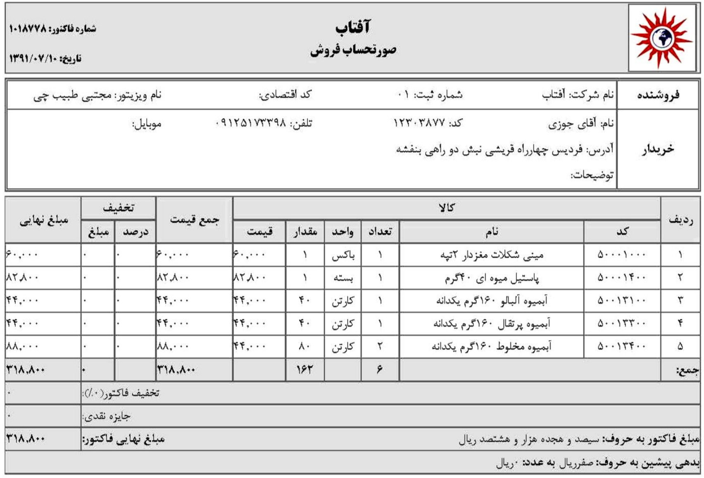
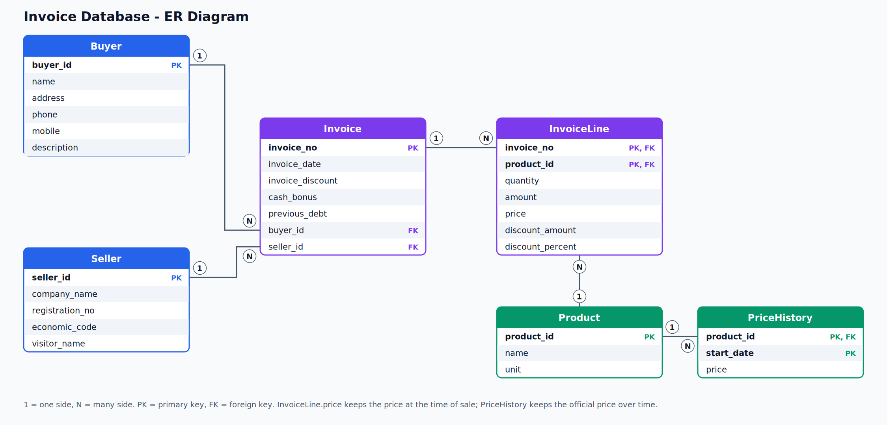

# طراحی پایگاه داده برای فاکتور فروش

تمرین درس پایگاه داده: طراحی یک دیتابیس رابطه‌ای برای نمایش «صورتحساب فروش» (فاکتور)، و سپس توسعهٔ آن به‌طوری که **تاریخچهٔ قیمت هر کالا** نگهداری شود.

پیاده‌سازی با **SQLite** و **Python** انجام شده است.

## صورت مسئله

بخش اول: پایگاه داده‌ای طراحی کنید که بتواند فاکتور فروش زیر را نمایش دهد.



بخش دوم: طراحی را طوری تغییر دهید که پایگاه داده بتواند **تاریخچهٔ قیمت** هر کالا را نگه دارد و نمایش دهد.

## نمودار ER



## جدول‌ها

| جدول | توضیح | کلید اصلی | کلیدهای خارجی |
|---|---|---|---|
| `Buyer` | خریدار | `buyer_id` | - |
| `Seller` | فروشنده (شرکت و ویزیتور) | `seller_id` | - |
| `Product` | کالا | `product_id` | - |
| `PriceHistory` | سابقهٔ قیمت هر کالا | `(product_id, start_date)` | `product_id` ← Product |
| `Invoice` | سرجمع فاکتور (تاریخ، تخفیف، جایزه، بدهی پیشین) | `invoice_no` | `buyer_id` ← Buyer، `seller_id` ← Seller |
| `InvoiceLine` | ردیف‌های فاکتور | `(invoice_no, product_id)` | `invoice_no` ← Invoice، `product_id` ← Product |

## رابطه‌ها

- هر **خریدار** چند فاکتور دارد، هر فاکتور یک خریدار (۱ به n)
- هر **فروشنده** چند فاکتور دارد، هر فاکتور یک فروشنده (۱ به n)
- هر **کالا** چند رکورد قیمت دارد، هر رکورد قیمت مال یک کالا است (۱ به n)
- **فاکتور و کالا** رابطهٔ چند به چند دارند: یک فاکتور چند کالا دارد و یک کالا در چند فاکتور می‌آید. این رابطه با جدول واسط `InvoiceLine` شکسته شده است.

## تصمیم‌های طراحی

**۱. چرا مبلغ نهایی، جمع ردیف‌ها و مبلغ به حروف ذخیره نشده‌اند؟**
این مقدارها از روی بقیهٔ داده‌ها محاسبه می‌شوند. ذخیره‌شان افزونگی ایجاد می‌کند و اگر داده‌ای عوض شود ممکن است با هم ناسازگار شوند. در عوض در موقع نیاز با پرس‌وجو محاسبه می‌شوند (نمونه در `queries.sql`).

**۲. چرا قیمت از جدول `Product` به جدول `PriceHistory` رفت؟**
اگر قیمت یک ستون در جدول کالا باشد، با هر تغییر قیمت، مقدار قبلی از بین می‌رود. در `PriceHistory` هر قیمت همراه با تاریخ شروع اعتبارش ذخیره می‌شود. کلید اصلی `(product_id, start_date)` است، چون هیچ‌کدام از این دو ستون به‌تنهایی یکتا نیستند.
قیمت معتبر یک کالا در یک تاریخ، آخرین رکوردی است که `start_date` آن کوچک‌تر یا مساوی آن تاریخ باشد.

**۳. چرا `price` در `InvoiceLine` ماند، با اینکه در `PriceHistory` هم هست؟**
- `PriceHistory` قیمت **رسمی** کالا در طول زمان است، ولی `price` در `InvoiceLine` قیمت **لحظهٔ فروش** است.
- ممکن است فروشنده به یک مشتری قیمتی غیر از قیمت رسمی بدهد.
- اگر سابقهٔ قیمت بعداً اصلاح یا ویرایش شود، فاکتورهای قبلاً صادرشده نباید تغییر کنند.
- نمایش یک فاکتور نیازی به جستجوی تاریخی ندارد.

**۴. چرا `InvoiceLine` کلید اصلی ترکیبی دارد؟**
شمارهٔ فاکتور تکرار می‌شود (هر فاکتور چند ردیف دارد) و کد کالا هم تکرار می‌شود (هر کالا در چند فاکتور می‌آید). ولی ترکیب این دو یکتاست. در این طراحی فرض شده یک کالا در یک فاکتور فقط یک ردیف دارد.

**۵. چرا `Seller` و `visitor_name` یک جدول هستند؟**
طبق نمونهٔ فاکتور، ویزیتور ویژگی فروشنده در نظر گرفته شده است. اگر یک ویزیتور بخواهد برای چند شرکت کار کند، بهتر است جدول جدا شود.

## ساختار پروژه

```
invoice-database-design/
├── README.md
├── schema.sql        ساخت جدول‌ها
├── test_data.sql     داده‌های آزمایشی (فاکتور نمونه)
├── queries.sql       پرس‌وجوهای نمونه
├── run.py            ساخت دیتابیس از روی schema.sql
├── test.py           وارد کردن داده و اجرای پرس‌وجوها
└── docs/
    ├── invoice.png       نمونه فاکتور (صورت مسئله)
    ├── er_diagram.png
    └── er_diagram.svg
```

## نحوهٔ اجرا

به Python 3 نیاز دارید (SQLite همراه آن نصب است و چیز اضافه‌ای لازم نیست).

```bash
python run.py     # ساخت دیتابیس invoice.db با شش جدول
python test.py    # وارد کردن داده‌های نمونه و اجرای پرس‌وجوها
```

اجرای دوبارهٔ `run.py` دیتابیس را از صفر می‌سازد. اگر فایل `invoice.db` در برنامه‌ای دیگر باز باشد، ابتدا آن را ببندید.

## خروجی نمونه

```
-- 2) قیمت معتبر مینی شکلات در تاریخ ۱۳۹۱/۰۸/۱۵
   ['price']
   (70000,)

-- 4) جمع کل فاکتور (محاسبه می‌شود، ذخیره نمی‌شود)
   ['total']
   (142800,)
```
